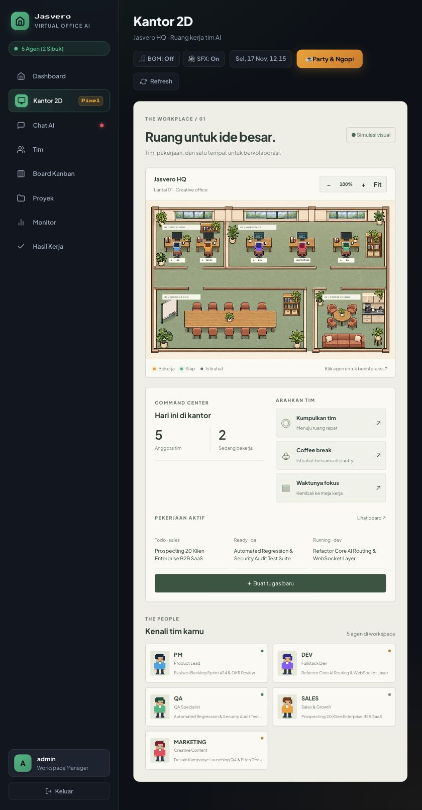

# 🏢 Jasvero Virtual Office AI

<p align="center">
  
</p>

<p align="center">
  <strong>Simulasi Kantor Virtual AI 2D Bergaya Retro Cozy (Stardew Valley) dengan Autonomous Agent Fleet, Live Kanban Board, dan Multi-Agent Chat Room.</strong>
</p>

<p align="center">
  <a href="#-fitur-utama"></a>
  <a href="#-quick-start"></a>
  <a href="#-open-contributor--cara-berkontribusi"></a>
  <a href="LICENSE"></a>
</p>

---

## 📖 Tentang Proyek

**Jasvero Virtual Office AI** adalah platform kolaborasi dan pemantauan agen kecerdasan buatan (*AI Fleet*) dengan antarmuka visual **2D Retro RPG (perspektif 3/4 oblique)** yang terinspirasi dari estetika game klasik seperti *Stardew Valley* dan *Habbo Hotel*.

Platform ini menggabungkan:
1. **Manajemen Tugas Nyata:** Papan Kanban interaktif, pelacak deliverable (*hasil kerja*), dan monitor performa agen.
2. **Autonomous AI Simulation:** Agen AI bukan sekadar angka di dashboard; mereka memiliki representasi avatar fisik 2D yang duduk mengetik saat sibuk (*running task*), berjalan menyusuri koridor, berkumpul di ruang rapat (*conference room*), dan minum kopi di pantry kafe saat santai (*idle*).
3. **Dedicated Chat AI:** Ruang obrolan langsung untuk setiap agen spesialis (*PM, Fullstack Dev, QA Automation, Sales Lead, Creative Marketing*).
4. **Zero-Dependency Architecture:** Backend ultra-ringan berbasis Node.js murni tanpa ketergantungan paket berat (*zero npm dependencies*), siap dihubungkan langsung ke backend AI Agent seperti **Hermes**.

---

## ✨ Fitur Utama

<p align="center">
  
  
</p>

### 1. 🎮 Denah Kantor 2D Ala Stardew Valley (3/4 Oblique Perspective)
- **Tekstur & Detail Retro:** Lantai kayu oak bertekstur serat (*parquet chevron*), dinding bata merah tavern, karpet tenun medallion Persian berumbai, dan taman luar dengan pepohonan buah apel & persik.
- **Ruangan Fungsional:**
  - 🏛️ **Lobby & Resepsionis:** Meja resepsionis kayu antik, bel emas, buku tamu, dispenser air galon, dan tanaman *fiddle leaf fig*.
  - 💻 **Ruang Dev & QA:** Stasiun kerja dual monitor dengan layar kode menyala (*IDE syntax highlighting*), keyboard mekanikal RGB, lampu meja banker kuningan, rak buku teknologi, dan server rack berkedip.
  - 📊 **Ruang Rapat (Conference):** Meja rapat oval mahoni kilap, 6 kursi kulit eksekutif, layar pintar presentasi burndown chart 75", mikrofon pod, dan jam dinding vintage.
  - ☕ **Pantry Cafe & Party Lounge:** Dinding bata kafe dengan neon sign *"CAFE & BAR ☕"*, deretan bendera pesta (*bunting*), mesin espresso Italia mewah dengan **animasi uap mengepul**, etalase donat & croissant, bar stool, sofa beludru zamrud Chesterfield, serta **retro jukebox 1950-an** dengan piringan hitam berputar dan nada musik melayang (`♪ ♫`).

### 2. 🚶 Autonomous AI Waypoint Walking Engine
- **Perilaku Agen Hidup & Mandiri:**
  - **Saat Sibuk (*Task Running*):** Duduk di meja kerja masing-masing, mengetik di keyboard dengan layar monitor aktif dan status bubble kerja.
  - **Saat Santai (*Idle / Nganggur*):** Secara otomatis berjalan melalui pintu dan koridor utama menuju **Pantry Cafe** untuk menyeduh dan menikmati kopi hangat (muncul cangkir kopi di tangan karakter!), atau berjalan ke **Ruang Rapat** untuk berdiskusi sprint.
- **Smart Waypoint Pathfinding:** Gerakan halus 60fps tanpa menembus dinding, dilengkapi ayunan kaki (*leg stride*), ayunan tangan seimbang (*arm swing*), pembalikan arah hadap (*directional flip*), dan bayangan lantai dinamis.
- **Kendali Instan (Toolbar):**
  - `☕ Ngopi di Pantry / Party All` — Panggil semua agen santai berpesta kopi di pantry.
  - `📢 Panggil Rapat` — Kumpulkan seluruh tim di meja konferensi.
  - `💻 Kerja di Meja` — Kembalikan semua agen ke workstation meja masing-masing.
  - Klik agen manapun di denah untuk membuka menu aksi cepat personal.

### 3. 💬 Saluran Chat AI Spesialis (Multi-Agent Tabs)
- Tab percakapan terpisah untuk masing-masing agen AI:
  - **Sarah (PM):** Product Lead & Sprint Coordinator.
  - **Alex (Dev):** Senior Fullstack & Cloud Architect.
  - **Maya (QA):** QA Automation & Security Specialist.
  - **Rian (Sales):** Business Development & Partnership Lead.
  - **Nadia (Marketing):** Creative Content & Growth Strategist.
- **Indikator Lokasi Real-time:** Menampilkan di mana agen berada (`📍 Pantry Cafe`, `📍 Ruang Rapat`, atau `📍 Meja Dev`).
- **Quick Action Prompts:** Tombol saran cepat kontekstual untuk memulai obrolan atau instruksi tugas.
- **Aksi Cepat di Chat:** Tombol *"☕ Ajak Ngopi"* dan *"📢 Ke Ruang Rapat"* langsung memicu pergerakan fisik karakter di denah kantor 2D.
- **Penyimpanan Lokal:** Riwayat obrolan tersimpan rapi di browser (*localStorage*).

### 4. 📋 Kanban Board & Monitoring Real-time
- Papan kanban responsif dengan fitur *drag-and-drop* kartu tugas.
- Kolom alur kerja lengkap: *Triage, Todo, Scheduled, Ready, Running, Blocked, Review, Done*.
- Halaman **Monitor Live** dengan auto-refresh tiap 5 detik untuk memantau beban kerja armada agen.
- Tab **Hasil Kerja** untuk membaca deliverable, dokumen, dan output selesai dengan penampil Markdown terintegrasi.

### 5. 🎵 Cozy 8-Bit Web Audio Synthesizer
- **Ambient Lo-fi BGM:** Generator musik melodi pentatonik santai ala pedesaan Stardew Valley menggunakan Web Audio API murni (tanpa file mp3/wav eksternal, latensi nol).
- **Retro Sound Effects (SFX):** Suara klik kayu retro, seruput kopi (*sip*), ping pesan masuk, dan fanfare selebrasi.

---

## 🏗️ Struktur Repositori

```bash
virtual-office-ai/
├── public/
│   ├── assets/
│   │   ├── office-floor.png             # Tekstur denah dasar kantor
│   │   ├── office-preview.jpg           # Preview utama denah 2D
│   │   ├── office-working-preview.jpg   # Preview area kerja
│   │   └── office-lounge-preview.jpg    # Preview cafe & lounge
│   ├── app.js                          # Client Engine: 2D Canvas, AI Pathfinding, Chat & Kanban
│   ├── index.html                      # Markup aplikasi, modal task & drawer agen
│   └── styles.css                      # Sistem desain: Retro 2D + Modern Dark Glassmorphism
├── server.js                           # Node.js zero-dependency HTTP server, proxy & fallback
├── package.json                        # Konfigurasi npm (opsional / script runner)
├── .gitignore                          # Aturan git ignore
└── README.md                           # Dokumentasi proyek
```

---

## 🚀 Quick Start (Cara Menjalankan)

### Prasyarat
- **Node.js:** Versi 18.0 atau lebih baru.
- Peramban web modern (Chrome, Edge, Safari, Firefox).

### 1. Clone Repositori
```bash
git clone https://github.com/Yansa27/virtual-office-ai.git
cd virtual-office-ai
```

### 2. Jalankan Server
Server dibuat tanpa dependensi npm eksternal, sehingga Anda tidak perlu menjalankan `npm install`. Cukup:

```bash
node server.js
```

### 3. Buka di Browser
Akses dashboard kantor virtual di:
👉 **[http://localhost:9120](http://localhost:9120)**

> **Catatan Login:**
> - Jika backend **Hermes** belum aktif, sistem secara otomatis mengaktifkan mode standalone simulasi. Masukkan username `admin` dan password `admin` untuk langsung masuk.

---

## 🤖 Integrasi dengan Hermes AI Agent

Secara default, `server.js` dikonfigurasi untuk mem-proxy permintaan autentikasi dan API kanban ke backend **Hermes** di `http://127.0.0.1:9119`:

| Variabel Lingkungan | Nilai Default | Keterangan |
| :--- | :--- | :--- |
| `PORT` | `9120` | Port HTTP Virtual Office |
| `HOST` | `0.0.0.0` | Host bind address |
| `HERMES_BASE` | `http://127.0.0.1:9119` | URL endpoint backend Hermes |

### Mengubah Port atau Target Hermes:
```bash
PORT=8080 HERMES_BASE=http://192.168.1.50:9119 node server.js
```

### Endpoint API yang Didukung:
- `POST /api/login` — Autentikasi sesi melalui Hermes password login.
- `GET /api/me` — Verifikasi identitas user aktif.
- `GET /api/kanban/board` — Mengambil data kolom dan task dari Hermes Kanban.
- `GET /api/kanban/profiles` — Mengambil daftar agen AI aktif beserta model & spesialisasi.
- `POST /api/kanban/tasks` — Membuat tugas baru untuk agen.
- `PATCH /api/kanban/tasks/:id` — Mengupdate status atau assignee tugas.

---

## 🤝 Open Contributor & Cara Berkontribusi

Proyek ini bersifat **terbuka untuk publik dan siap menerima kontribusi** dari komunitas! Baik berupa penambahan aset piksel, perbaikan bug, peningkatan alur kerja AI, maupun fitur interaktif baru.

### Area Kontribusi yang Sangat Diapresiasi:
- 🎨 **Aset Piksel & Dekorasi Baru:** Menambahkan variasi tanaman, konsol game arcade, aquarium, atau tema musim (*Salju/Winter, Musim Gugur/Autumn*).
- 🚶 **Perilaku AI Tambahan:** Variasi pose karakter (misal: menyiram tanaman, bermain gitar akustik, membaca buku di sofa).
- 🔌 **Integrasi Backend AI Baru:** Adapter untuk Ollama, OpenRouter, AutoGen, CrewAI, atau LangGraph.
- 📱 **Peningkatan Mobile / Tablet:** Optimasi gestur pinch-to-zoom dan kontrol sentuh.

### Alur Berkontribusi:
1. **Fork** repositori ini ke akun GitHub Anda.
2. Buat branch fitur baru:
   ```bash
   git checkout -b feature/nama-fitur-keren
   ```
3. Lakukan perubahan dan pastikan kode berjalan dengan rapi (`node -c server.js` dan `node -c public/app.js`).
4. Commit perubahan Anda dengan pesan yang deskriptif:
   ```bash
   git commit -m "feat: tambahkan dekorasi arcade cabinet di ruang dev"
   ```
5. Push ke branch Anda:
   ```bash
   git push origin feature/nama-fitur-keren
   ```
6. Buka **Pull Request (PR)** baru di GitHub dan jelaskan fitur yang Anda tambahkan!

---

## 🗺️ Roadmap Pengembangan

- [x] Desain denah kantor 2D ala Stardew Valley (perspektif 3/4 oblique).
- [x] Sistem waypoint pathfinding koridor untuk navigasi autonomous agent.
- [x] Perilaku agen saat idle: ngopi di pantry, santai di sofa, rapat di conference room.
- [x] Tab chat mandiri untuk masing-masing agen spesialis.
- [x] Generator Web Audio API untuk BGM Lo-Fi retro dan SFX interaktif.
- [x] Pembersihan data dummy dan persiapan integrasi Hermes.
- [ ] Siklus Siang/Malam dinamis dengan efek pencahayaan lampu jendela (*Day/Night Lighting Layer*).
- [ ] Fitur customisasi avatar agen oleh pengguna (*Skin / Hair Customizer*).
- [ ] Suara bicara chiptune (*animalese-style speech blips*) saat agen membalas pesan.
- [ ] Dukungan WebSocket langsung untuk pembaruan task dan posisi agen tanpa polling.

---

## 📄 Lisensi

Proyek ini dilisensikan di bawah lisensi [MIT](LICENSE) — Anda bebas menggunakan, memodifikasi, dan mendistribusikannya untuk keperluan pribadi maupun komersial.

---

<p align="center">
  Dibuat dengan ❤️ untuk komunitas AI & Game Developer oleh <strong><a href="https://github.com/Yansa27">Jasvero Digital</a></strong>.
  <br>
  <em>Bintang ⭐ dan kontribusi Anda sangat berarti bagi pengembangan proyek ini!</em>
</p>
